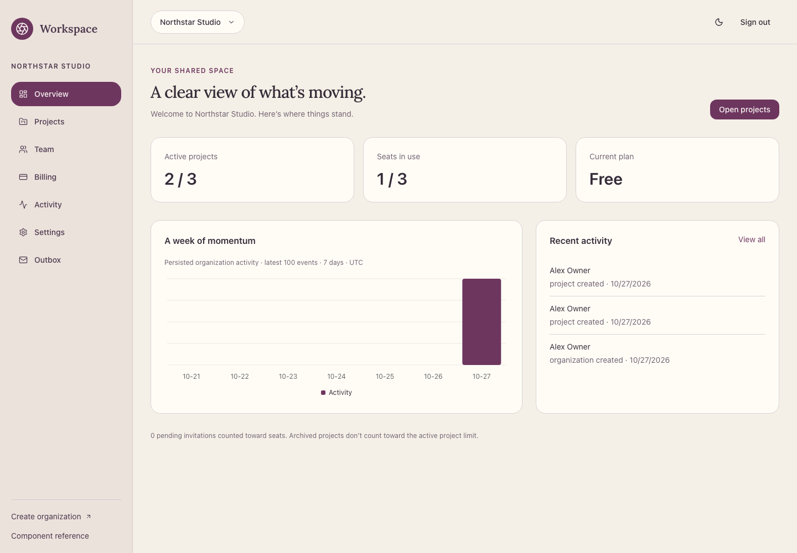

<!-- filename: README.md -->

# SaaS Starter



A complete team-projects foundation built from **Admin Starter**. One modular
Next.js App Router application, one deployable Node.js process, and Onyx for all
application data. Firebase supplies application identity; Stripe and SMTP are
optional. No separate backend, worker, CMS, or hosting adapter.

## Start

Use **Node.js 24.12+** (`.nvmrc` pins 24.22.1) and npm. Current Firebase 13 requires
Node 24; this starter deliberately raises the Admin Starter runtime requirement.

```sh
npm ci
cp .env.example .env.local
npm run setup:secrets
```

Fill in your **application's** Firebase settings and `APP_ORIGIN`, use the existing
Onyx downloaded configuration, then perform the explicit schema setup below.

```sh
npm run schema:validate
npm run schema:diff
npm run schema:publish      # review the diff; targets your configured database
npm run dev -- --port 3000
```

Open `http://127.0.0.1:3000`. Create an account, verify its email, create an
organization, and create your first project. Authenticated application routes live
under `/app/<organization-id>`. Missing Firebase or Onyx configuration produces
setup guidance or a safe dependency error, never fabricated records or an
in-memory runtime fallback. Set `APP_ORIGIN` to the exact browser origin, without
a trailing slash, including the assigned development port or preview hostname.

Next loads `.env.local`; standalone schema/seed commands do not. Export the
configuration names needed by those commands in your shell (or use the SDK's
project-root downloaded file and application-default Firebase credentials).
Never paste secrets into source, chat, git, or `NEXT_PUBLIC_*` variables.

## Application map

| Route                                   | Purpose                                                            |
| --------------------------------------- | ------------------------------------------------------------------ |
| `/`, `/pricing`                         | Public landing and clearly illustrative plans                      |
| `/sign-up`, `/sign-in`, `/verify-email` | Firebase application authentication                                |
| `/onboarding`                           | Create an organization; creator becomes its first owner            |
| `/app`                                  | Resolve an authorized organization or start onboarding             |
| `/app/<id>`                             | Persisted counts, seat usage, actual activity chart                |
| `/app/<id>/projects`                    | Searchable, sortable, paginated project table; create/edit/archive |
| `/app/<id>/team`                        | Membership roles, departure/removal, invitations and revocation    |
| `/app/<id>/billing`                     | Usage, demonstration plans, optional Stripe and reconciliation     |
| `/app/<id>/activity`                    | Latest 100 organization audit events                               |
| `/app/<id>/settings`                    | Application profile and organization settings                      |
| `/app/<id>/outbox`                      | Authenticated, organization-scoped invitation previews             |
| `/invite/<id>?token=...`                | Verified-email, one-time invitation acceptance                     |
| `/components`                           | Protected Admin Starter component reference                        |
| `/api/health`, `/api/ready`             | Process liveness and bounded dependency readiness                  |
| `/api/stripe/webhook`                   | Signature-verified Stripe event processing                         |

The responsive UI uses a distinct Parchment / Aubergine / Clay theme, Manrope
body text and Lora headings, with coordinated light/dark modes, keyboard focus, accessible labels,
form validation and success/error states. Theme tokens live in `app/globals.css`.
The original reusable UI components remain available. Charts display persisted
organization audit activity and explicitly identify their recent-event window.
Public marketing illustrations and pricing are labeled illustrative.

## Architecture and ownership

```text
app/                     public/protected routes and integration endpoints
components/saas/         application forms, table, chart, shell and feedback
components/ui/           inherited shadcn/Radix primitives; shadcn chart component
modules/auth/            Firebase initialization and verified HttpOnly sessions
modules/organizations/   membership scope, permissions, locks and invitations
modules/projects/        organization-scoped project rules and persistence
modules/billing/         plans, demo/Stripe providers, durable reconciliation
modules/notifications/   React Email, encrypted outbox, optional SMTP adapter
modules/actions.ts       authenticated, validated application Server Actions
lib/onyx/                lazy official SDK adapter and generated schema types
api/onyx.schema.json      explicit typed application schema
scripts/                 schema setup, seed, naming and operator recovery
```

Server Components own initial reads. Server Actions own application mutations;
Route Handlers own session exchange, liveness/readiness and Stripe webhooks.
Services validate scope and permissions on every call, including inside locks.
Client state does not establish identity, organization access or entitlements.
The browser never imports privileged SDKs. All live data reads use no-store;
request-local React cache only deduplicates Firebase session verification.

## Firebase and private previews

Configure Email/Password sign-in and authorized application domains in your
Firebase project. The public Firebase config identifies the project and is not
an administrative secret. Public settings are inlined into the browser at build
time; rebuild when changing them. Server settings:

- `FIREBASE_PROJECT_ID` (must match the client project).
- `FIREBASE_SERVICE_ACCOUNT_BASE64`: base64-encoded service-account JSON, matching
  the repository's existing Firebase convention; or use Application Default
  Credentials via `GOOGLE_APPLICATION_CREDENTIALS` / the platform identity.
- `APP_ORIGIN`: exact application origin. HTTPS is required for internet use.

After a recent Firebase sign-in (less than five minutes), `/api/auth/session`
verifies the ID token and creates a five-day HttpOnly, SameSite=Lax session
cookie. HTTPS cookies are Secure. Every private request verifies that cookie with
revocation checks, looks up the Firebase user, rejects disabled accounts, and
uses the current verified email. Sign-out clears the browser session cookie;
Firebase token revocation remains available to operators for compromised sessions.

This follows the existing Firebase configuration/verification pattern using the
official Node Admin SDK, rather than copying the host's edge shim. Existing Onyx
private-preview access remains the workspace's outer access gate. Its session,
preview cookie, gateway identity and task credentials are **not application
users**, and are never mapped to memberships or trusted as arbitrary headers.
Users still sign in to the application's Firebase project inside private previews.
A published application requires its own Firebase session, never an Onyx preview
session or `WORKSPACE_PREVIEW` bypass. See `docs/authentication.md`.

## Onyx schema and data

Use official `@onyx.dev/onyx-database` **2.8.4**, Node runtime, and its existing
resolution chain: environment / `ONYX_CONFIG_PATH` / downloaded project config /
home profile. Prefer the downloaded `onyx-database.json` in the project root or
an existing absolute `ONYX_CONFIG_PATH`; these are ignored by git. Onyx 4.2.9+
is required for insert-only creation and locks.

The ten explicit tables are Profile, Organization, Membership, Invitation,
Project, Subscription, BillingEvent, Notification, AuditEvent and MutationLock.
Structured state uses typed attributes, not opaque JSON blobs. Indexes cover
organization, membership/user, email, status, customer and time queries.

```sh
npm run schema:validate    # local structural validation only
npm run schema:generate    # official generator; timestamps emitted as strings
npm run schema:diff        # read current schema and inspect additive changes
npm run schema:publish     # explicit configured-database schema operation
```

Publishing preserves unrelated tables and compatible definitions. Incompatible
existing identifiers, types or nullability fail for review. Coordinate with other
schema operators. Schema creation and seed writes never run in module imports,
startup, health probes, tests or builds. Generated types are checked into
`lib/onyx/generated.ts`; Zod validates actual records at the SDK boundary.

### Idempotent development sample data

First create a real, verified application user. With Firebase server configuration
and Onyx settings exported for the CLI:

```sh
npm run seed -- --user-uid <verified-firebase-application-user-uid>
```

The command verifies that Firebase user, derives stable organization/project
request IDs, creates an owned sample organization and two projects, and preserves
existing records and user edits on repeat runs. It never creates a hard-coded
production identity or grants access from an email string. Normal accounts begin
empty. Do not seed a production database with demonstration business content.

## Permissions and tenant isolation

| Permission                                                        | Owner                         | Admin | Member |
| ----------------------------------------------------------------- | ----------------------------- | ----- | ------ |
| Read organization, projects, usage, activity and member directory | Yes                           | Yes   | Yes    |
| Create/edit/archive projects                                      | Yes                           | Yes   | Yes    |
| Edit organization                                                 | Yes                           | Yes   | No     |
| Invite members, revoke invitations, use scoped outbox             | Yes                           | Yes   | No     |
| Invite admins or change administrators/owners                     | Yes                           | No    | No     |
| Remove ordinary members                                           | Yes                           | Yes   | No     |
| Leave own membership                                              | Yes, if another owner remains | Yes   | Yes    |
| Billing, checkout/portal, event retry/reconcile                   | Yes                           | No    | No     |

Membership IDs are deterministic organization/user pairs. Every record-ID mutation
loads and checks its organization after validating membership. Queries, aggregates
and notifications use that same organization scope. A browser organization ID is
only a locator. Private outbox HTML and invitation links never appear publicly.

### Concurrency and recovery

Onyx insert-only MutationLock IDs serialize all organization mutations across
application instances. The lock is acquired before rechecking access and counting
owners/projects/seats. Owner departure/demotion preserves at least one active
owner; pending unexpired invitations reserve seats. Invite acceptance validates a
verified matching email, token hash, expiry and state under the same lock.
Accepted replays are harmless only for the same still-active membership; a
consumed token cannot reactivate a departed user. Revocation invalidates previews.

This starter does **not** claim general transactions, atomic filtered CAS, automatic
lock expiry, or exactly-once multi-table writes. Known precondition conflicts
release the lock; uncertain storage failures retain it. This favors preserving
invariants over availability. Partial work can exist after a failure and needs
operator inspection. Stop **every writer**, inspect the affected records, then:

```sh
npm run lock:recover -- --scope organization:<id> --confirm-writers-stopped
# For interrupted organization creation, use --scope user:<firebase-uid>.
```

Retry the original idempotent create/accept/event action where supported. Never
blindly delete locks or use TTL takeover while a writer might still run. Project
edits use last-write wins inside this exclusion. Requests and queries are bounded;
aggregate scans stop at 2,000 rows per scoped query. Add database aggregates or
incremental counters and indexed pagination before exceeding that starter budget.

## Plans and optional billing

Free defaults to 3 active projects / 3 seats. Team defaults to 50 / 20. Configure
`FREE_PROJECT_LIMIT`, `FREE_SEAT_LIMIT`, `TEAM_PROJECT_LIMIT`, `TEAM_SEAT_LIMIT`
(1–1,000). Active memberships plus unexpired pending invitations count as seats.
Archived projects do not consume active-project limits. Downgrades preserve data;
over-limit organizations cannot create more projects/invitations until usage fits.

Modes are selected on the server:

- `BILLING_MODE=disabled` (default): enforce Free limits; no billing vendor needed.
- `BILLING_MODE=demo`, `ALLOW_DEMO_BILLING=1`, `APP_ENV=development` or `preview`:
  explicitly labeled, persisted **demo** subscriptions with no charges. Production
  activation is rejected, and Stripe mode never grants access from a demo row. A production Node process
  treats APP_ENV=development as production; only an explicit preview opt-in may
  exercise demo billing in a production preview build.
- `BILLING_MODE=stripe`: configure `STRIPE_SECRET_KEY`, `STRIPE_TEAM_PRICE_ID`,
  `STRIPE_WEBHOOK_SECRET` and `APP_ORIGIN`. Only Stripe test keys are accepted
  outside `APP_ENV=production`. Configure the Stripe customer portal separately.

Stripe provides subscription Checkout and portal sessions. Only owner actions may
create them; the customer mapping is persisted before checkout. A return URL does
not grant access. Configure checkout.session.completed and customer.subscription
lifecycle webhooks at `/api/stripe/webhook`. The handler verifies the signature
against bounded raw bytes before persisting normalized event state in Onyx.

Event IDs are durable, duplicate successes are ignored, failed attempts are kept,
and owners can retry them. Each event re-reads the customer's current Stripe
subscription state under the organization lock, instead of trusting event order
or browser metadata. Only a linked matching configured price with active/trialing
Stripe state grants Team access. Out-of-order events therefore reconcile current
provider state. Scan bounds reject ambiguous oversized customer histories.
Use “Reconcile subscription” after operator/provider changes; Stripe retries failed
webhooks with 5xx responses. No live charge or provider API mutation was performed
during implementation/tests. A fresh development database is recommended when
switching between demonstration and real billing; demo subscriptions are never
silently converted to Stripe records.

## Email and authenticated outbox

React Email renders invitations. `MAIL_MODE=outbox` is the default: organization
owners/admins review an authenticated email preview and share its one-time link.
Invitation tables store only token hashes. Outbox token material is encrypted with
AES-256-GCM using `NOTIFICATION_ENCRYPTION_KEY`; the key must remain stable and be
backed up securely. Acceptance/revocation clears the encrypted outbox token.

`npm run setup:secrets` creates that key in ignored, mode-0600 `.env.local` without
printing it or overwriting an existing key. The CLI does not source that file;
export the key when invoking notification-related CLI operations.

Optional `MAIL_MODE=smtp` uses `SMTP_HOST`, `SMTP_PORT`, `SMTP_USER`,
`SMTP_PASSWORD`, and `MAIL_FROM`. Creation still persists the notification;
“Send via SMTP” performs an explicit authenticated delivery. TLS is required,
network calls are bounded, attempts and failures are persisted, and sent records
are not automatically resent. A crash during SMTP may leave `sending` with an
uncertain external result: review the provider/mailbox before an operator resets
it to failed. SMTP cannot guarantee exactly-once delivery; no background worker
or automatic resend loop is included. No real email was sent during implementation.

```sh
npm run emails:preview     # local React Email template development UI
```

## Verification

```sh
npm run check             # lint, strict types, formatting, dead code, unit/RTL, build
npm run test:e2e          # official Firebase Auth Emulator + explicit SDK HTTP fixture
npm run schema:validate
npm run template:smoke  # fresh copy/install/name/check/build, no live services
npm run build
npm start -- --port 3000
```

Browser tests require Java 21+ for the official Firebase Auth Emulator. The runner
uses a demo project, clears only that local emulator's test users, creates verified
emulator accounts through Firebase Admin, and signs in through the real client SDK
and real session exchange. `FIREBASE_AUTH_EMULATOR_HOST` is rejected in production,
requires a `demo-` project, and must be loopback. The test-only Onyx HTTP transport
lives under tests; it is never imported by application code. Private preview or
arbitrary identity headers do not establish application access.

`npm run test:preview` runs that isolated environment on port 3225 for inspection.
It does not prove live Onyx persistence. Do not point these commands at live users,
Stripe accounts, or SMTP services. Actual results and limitations are recorded in
`docs/verification.md`. Production builds require no Firebase/Onyx connection.

Installing and starting the template never publishes schemas, deploys an application,
creates charges, or sends email automatically. Those are explicit operator actions.
